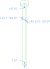
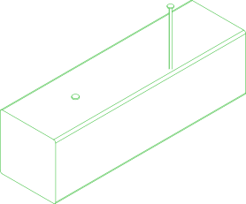
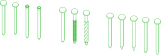

# //pub/std/fastener/nail

Nails for timber construction, classified by ASTM F1667, F547 and C514 and by EN 14592 and EN 1995-1-1: the interfaces they are driven through and held by, and the imperial and metric nails in two sub-packages.

Nails for timber construction, as parametric parts with four ports, and the
interfaces that say where a nail can go, which nails can go there, which of
them can go there outdoors, and how a nail is held while it is driven.

The nails are in two sub-packages, as their standards are:

* [`//pub/std/fastener/nail/imperial`](README_imperial.md) - the ASTM F1667
  styles: common, box, sinker, cooler, finishing, casing, gypsum wallboard,
  roofing and connector nails, by pennyweight and gauge
  ([every size](CATALOGUE_imperial.md)).
* [`//pub/std/fastener/nail/metric`](README_metric.md) - the DIN 1151 sizes,
  flat and countersunk, with EN 10230-1's heads, and a nail of any size as
  EN 14592 has one declared ([every size](CATALOGUE_metric.md)).

The interfaces are here, and are the same for both: a 0.131 in. 8d common
and a 3.4 x 90 mm wire nail go into the same places, by the same rules.

<table><tr>
<td align=center valign=bottom><a href="./common/16d.ports.svg"></a><br/>The four ports of <code>imperial:common/16d</code></td>
<td align=center valign=bottom><a href="./example/indoor.svg"></a><br/><code>example/indoor</code></td>
<td align=center valign=bottom><a href="./example/outdoor.svg"></a><br/><code>example/outdoor</code></td>
</tr></table>

<a href="./example/anatomy.svg"></a><br/>
<code>example/anatomy</code>: four heads (flat, countersunk, casing, brad), three shanks
(smooth, ring, screw) and five points (diamond, long diamond, needle, blunt, chisel).

| Interface | What it is |
|---|---|
| `nail-target;width=,depth=` | A place to drive a nail into: any nail up to `width` mm, up to `depth` mm deep. The connection's `drive` says how far in. |
| `nail-target-outdoor;width=,depth=` | The same, outdoors: outdoor nails only. |
| `nail-point;d=` | A nail's tip, by its shank to 0.1 mm - what decides where it fits. |
| `nail-point-outdoor;d=` | The tip of a nail that lasts outdoors: hot-dip galvanized, stainless or copper. It fits indoor targets too. |
| `nail-grip;d=` | One grasp across the shank: two opposite ports for a gripper's two jaws. What every catalogue nail is held by. |
| `nail-head` | Where a hammer, a nailer's driver or a nail set strikes. |

[INTERFACES.md](INTERFACES.md) says how each of them works and why - the
four ports, the 0.1 mm inheritance chain that lets a target take every
nail not wider than it, why an outdoor target is a sibling of the indoor
one rather than its child, and which finishes count as outdoor.
[CLASSIFICATION.md](CLASSIFICATION.md) maps the parameters onto ASTM F1667,
F547 and C514 and onto EN 14592, EN 10230-1 and EN 1995-1-1, and lists the
sources.


## Usage
```shell
pc list parts -r //pub/std/fastener/nail                   # every nail
pc info -i "//pub/std/fastener/nail:nail-target;width=6,depth=88.9"
pc render -t svg --with-ports //pub/std/fastener/nail/imperial:common/16d
pc test -a //pub/std/fastener/nail:example/indoor          # nails driven into a post
```

From another package, a place to nail into:

```yaml
parts:
  deck-board:
    # ...
    implements:
      "//pub/std/fastener/nail:nail-target-outdoor;width=4.2,depth=60":
        A: [[20, 70, 25], [1, 0, 0], 180]
```


## Assemblies

### example/anatomy
<table><tr>
<td valign=top><a href="example/anatomy.assy"></a></td>
<td valign=top>The words of the classification, left to right: four heads (flat, countersunk, casing, brad), three shanks (smooth, ring, screw) and five points (diamond, long diamond, needle, blunt, chisel)</td>
</tr></table>

### example/indoor
<table><tr>
<td valign=top><a href="example/indoor.assy"></a></td>
<td valign=top>An indoor post takes any nail - an imperial one, bright, driven home, and a metric one, galvanized, being driven</td>
</tr></table>

### example/outdoor
<table><tr>
<td valign=top><a href="example/outdoor.assy"></a></td>
<td valign=top>An outdoor post takes outdoor nails only - an imperial one, galvanized, driven home, and a metric one, stainless, being driven</td>
</tr></table>

<br/><br/>

*Generated by [PartCAD](https://partcad.org/)*
